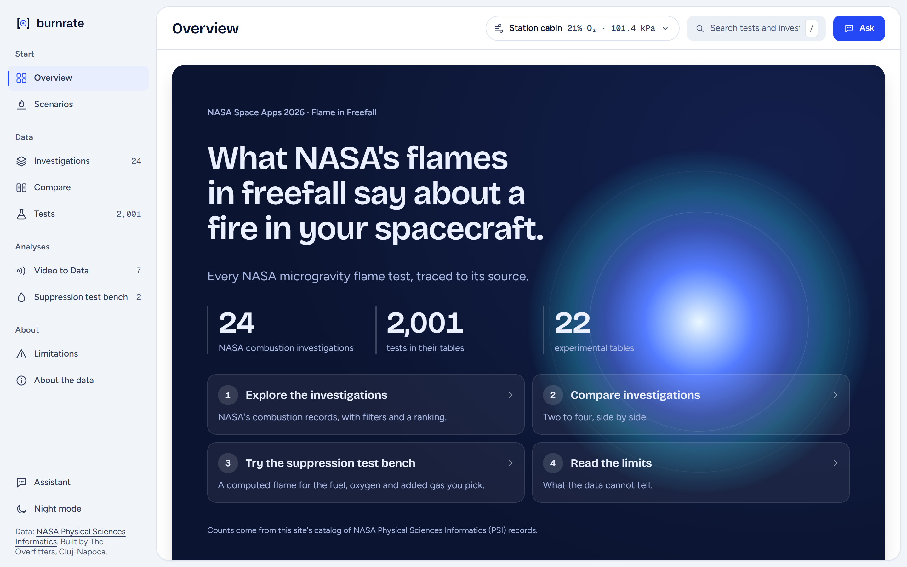
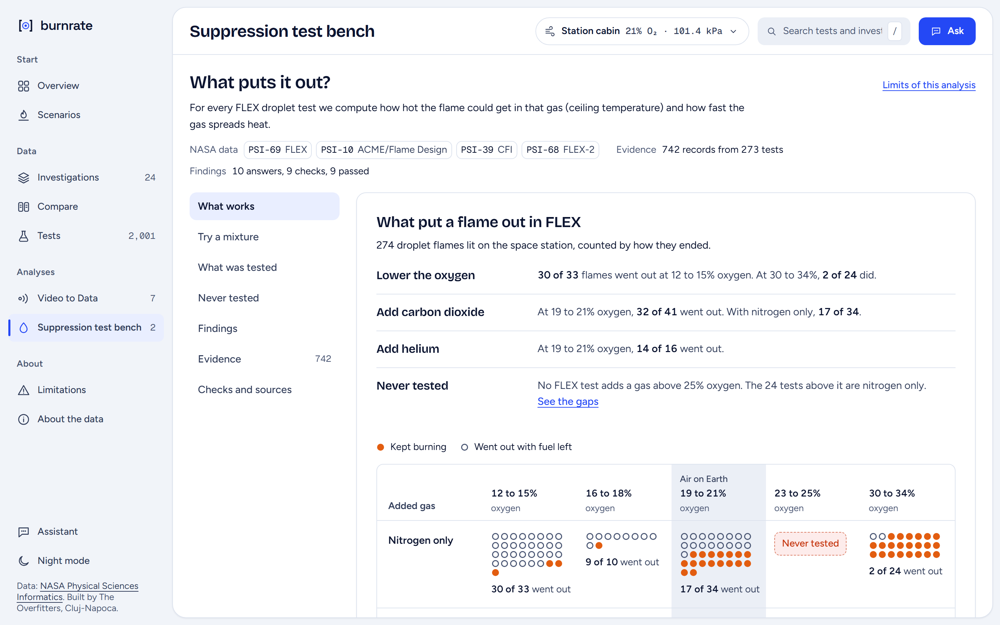

# burnrate

**Every NASA microgravity flame test, traced to its source.**

The entry of team The Overfitters (Local Event in Cluj-Napoca, Romania) for the NASA Space
Apps Challenge 2026, challenge **"Flame in Freefall"**.

- **Live site:** https://burnrate-psi-rosy.vercel.app (public, no login)
- **Demo video (30 seconds):** https://youtu.be/ONnKjQW7STY (public, no login)
- **Source:** https://github.com/d0br1n/flame-in-freefall (this repository)

## The challenge

NASA asks for a dashboard that summarizes, ranks and interprets its combustion experiments, so
that fire-safety insight is easier to reach. The experiments sit in one public archive, the
Physical Science Informatics (PSI) database: 24 combustion investigations, most of them flown on
the space station, with hundreds of files each. A crew or a mission designer needs to know two
things about a fire in a spacecraft: will it spread, and what puts it out. The archive does not
answer them directly.

## What we built

A website where a visitor picks the air inside a cabin (oxygen, pressure, airflow) and sees
what NASA's flight tests say about a fire in it.

- **Catalog.** All 24 investigations, a page for each, and one tests explorer that puts the
  2,001 tests of the 22 experimental tables on shared columns. Every test opens its PSI file
  and row.
- **Video to Data** (PSI-25, BASS-II). A tracker follows the flame in NASA's videos and turns
  each test into measurements: ignition, extinction and spread rate. 18 of the 22 B-series
  tests are measured, in pixels per second, because the videos show no scale.
- **Suppression test bench** (PSI-69, FLEX). For 273 of the 274 droplet tests it computes how
  hot the flame could get in that mix of oxygen and inert gas, and shows which mixes were never
  flown. The calculation is checked against NASA's own flame temperatures in PSI-10 (off by
  2.5 K at the median over 147 flames).
- **Evidence panel.** Every number opens a panel that says how it was obtained (measured from
  video, read from NASA's table, published by NASA, computed, or read by SI), names the PSI
  file and links to the investigation on psi.nasa.gov.
- **Compare, Limitations and Ask burnrate.** Up to four investigations side by side; one page
  that gathers what the data cannot tell; and an assistant that answers only from the site's
  own data and cites the PSI investigations it used.

## Why it matters

The next crewed missions go to the Moon and on to Mars, where cabin air and gravity differ
from the tests that exist. A tool that shows which tests cover a cabin, and which do not, tells
engineers where the evidence is thin. It also makes NASA's open data usable for researchers,
students and anyone planning the next experiment.

## What is new compared with the PSI site

PSI lets you search investigations and download files. burnrate adds:

- one table across all tests, instead of one file per investigation;
- a view by cabin air instead of by investigation, with a ranking that writes out its reasons;
- numbers measured from the BASS-II videos (PSI-25), which PSI holds only as video;
- every check shown on the page it belongs to, including the ones that have not passed or
  have not been run yet.

## For judges: where each criterion shows

| Criterion | What to look at | Where |
|---|---|---|
| **Impact** | A safety engineer or mission designer sees which flight tests cover a cabin air and which do not. "Never tested" proposes the next experiment: 6 gas mixtures at 30 to 34% oxygen, where all 24 FLEX tests (PSI-69) used nitrogen only | [Suppression test bench](https://burnrate-psi-rosy.vercel.app/suppress), [Scenarios](https://burnrate-psi-rosy.vercel.app/scenarios) |
| **Creativity** | Measurements taken from NASA's own videos, a view by cabin air, and an evidence panel behind every number | [Video to Data](https://burnrate-psi-rosy.vercel.app/spread), [What is new](#what-is-new-compared-with-the-psi-site) |
| **Validity** | Each analysis is checked against NASA's published values, failed checks stay visible, and the limits have their own page | [How we checked it](#how-we-checked-it), [Limitations](https://burnrate-psi-rosy.vercel.app/limitations) |
| **Relevance** | The three verbs of the challenge: summarize (catalog of 24 investigations), rank (ranking for the chosen air) and interpret (two analyses and a cited assistant). PSI is the only data source | [Overview](https://burnrate-psi-rosy.vercel.app), [Investigations](https://burnrate-psi-rosy.vercel.app/investigations), [NASA data used](#nasa-data-used) |
| **Presentation** | A public site with no login, a 30-second demo, plain language, real screenshots | [Demo video](https://youtu.be/ONnKjQW7STY), [project page text](submission/PROJECT_PAGE.md) |

## NASA data used

All data comes from NASA's Physical Science Informatics (PSI) database, https://psi.nasa.gov.
Remove PSI and nothing on the site remains.

| PSI investigation | What it gives burnrate |
|---|---|
| All 24 combustion investigations: PSI-10, 20, 21, 22, 23, 25, 26, 39, 47, 68, 69, 98, 99, 100, 101, 102, 106, 107, 159 and the ground studies 60, 62, 115, 117, 142 | The catalog: objective, approach, hardware, publications, and the 22 experimental tables (2,001 tests) behind the tests explorer |
| **PSI-25**, BASS-II (DOI 10.60555/4qc4-de67) | The flame videos that Video to Data measures, the experimental table (129 tests), and the BASS-II Summary Report (NASA/TM-20210011385) for published reference values |
| **PSI-69**, FLEX (DOI 10.60555/mbq8-0451) | The 274 droplet tests of the Suppression test bench: fuel, oxygen, inert gas, pressure and how much fuel burned |
| **PSI-10**, ACME Flame Design (DOI 10.60555/w4zy-bt45) | NASA's own computed flame temperatures, used to check our calculation |
| PSI-101 (SAME-R) and PSI-47 (DAFT, DAFT-2) | Catalog only: smoke detection is a filter of the Investigations list, there is no detection engine |

One row per investigation, with licence and link, is in [submission/REFERENCES.md](submission/REFERENCES.md).
What the downloaded files really contain, and the pitfalls we hit, is in the
[PSI data verification report](docs/PSI_VERIFICATION_REPORT.md).

## How we checked it

- **Suppression test bench against NASA (PSI-10).** Our calculated flame temperatures differ
  from NASA's own by 2.5 K at the median, over 147 flames.
- **Video to Data against NASA's report (PSI-25).** In test B1 the flame left the video 1.6 s
  after the fan began to slow; NASA's Summary Report says "within 2 s". A blind SI grader
  matched NASA's published outcome in 10 of 11 fabric (T-series) tests, with 1 undecided and
  0 contradictions.
- **A check that does not pass yet.** The tracker against SI-made markings on 5 tests differs
  by 2.5 pixels per second on average (26%), above our own 25% limit. The Video to Data page
  shows it test by test.
- **Not done yet.** No independent hand measurement, and no comparison with NASA's published
  spread rates (pixels against millimetres).
- **Software.** 694 Python tests, 493 unit tests for the website and 13 end-to-end browser test files. Every
  change reaches `main` through a pull request that merges only when one gate is green
  (`tools/ci/gate.py`): tests with no skips allowed, files that parse, no leaked credentials,
  English only, every dependency in the references ledger, SI use declared. Engine outputs are
  checked against a written contract (`contracts/validate.py`).

## What the data cannot tell

- No PSI test was run in Moon or Mars gravity.
- The BASS-II table has no spread-rate or outcome column, so those numbers come from the
  videos. A dim flame can vanish from the video before it is out, and without a scale in the
  frame the rates cannot be given in millimetres per second.
- The tracker has not yet been checked against an independent hand measurement.
- The test bench temperatures are calculated for ideal burning, not measured. With helium,
  temperature alone does not explain the result.
- Nothing here is a safety certification. The site shows where the evidence is, not which
  material is safe.

## How to run it

- **Checks and tests:** `python3 tools/ci/gate.py --base origin/main` (the same gate CI runs;
  Python 3.12 and `uv` are needed, see `tools/install-hooks.sh`).
- **Backend** (`apps/api/`, FastAPI, read-only), from the repo root:
  `uv venv -p 3.12 .venv && uv pip install --python .venv/bin/python -r apps/api/requirements.txt`,
  then `.venv/bin/uvicorn --app-dir apps/api app.main:app --port 8000`. It serves the catalog
  database in `data/build/` and the engine folders in `data/modules/`, both in git, so the site
  runs without downloading anything.
- **Website** (`apps/web/`, Next.js): `npm ci`, then `API_ORIGIN=http://127.0.0.1:8000 npm run dev`.
  More in [apps/web/README.md](apps/web/README.md).
- **Pipeline:** each part has its own folder under `pipeline/` with a README that gives its run
  command (for example `pipeline/video_to_data/`). They read `data/raw/` and write
  `data/build/` and `data/modules/`.
- **Contract check:** `python3 contracts/validate.py data/modules/<engine>`.
- **Raw PSI files:** `data/raw/` is not in git (about 120 MB). Only the pipeline needs it.
  Download it from NASA's PSI API as described in the
  [verification report](docs/PSI_VERIFICATION_REPORT.md).

## Repo layout

| Path | What it holds |
|---|---|
| `apps/web/` | The website (Next.js) |
| `apps/api/` | The one read-only backend (FastAPI) that serves the catalog and every engine folder |
| `pipeline/` | Offline code that turns the raw PSI files into the catalog (`pipeline/catalog/`) and the two engines' outputs (`video_to_data/`, `flame_temperature/`), with shared table readers in `pipeline/common/` |
| `data/build/` | The catalog database built by the pipeline |
| `data/modules/` | One folder per engine (`video-to-data/`, `flame-temperature/`), each with `module.json`, `evidence.json` and `findings.json`, plus `_mock/` for development only |
| `contracts/` | The hand-over contract: schemas for the engine files and the one validator |
| `tests/`, `apps/api/tests/`, `apps/web/tests/` | The test suites |
| `docs/` | Official challenge description and resources (`00` to `10`), architecture, data verification report, deploy notes |
| `submission/` | The project page text, the demo video and deck, screenshots, the references ledger and the SI usage ledger |
| `design/` | The design sheets of the product |
| `modal/` | One training script that runs on Modal (`train_flex.py`) |
| `tools/`, `.github/workflows/` | The integrity gate, the landing scripts and CI |
| `.claude/skills/psi-api/` | The PSI API client the pipeline downloads the raw files with |

The team's working notes (`research/`) and the setup of the SI coding sessions are kept in the private working repository and are not part of this public copy.

## Docs

- [Challenge description](docs/00-challenge-description.md): what NASA asks for. Together with the resource files `01` to `10` next to it, this is our source of truth
- [NASA's challenge text, word for word](docs/challenge-text-verbatim.md)
- [Architecture](docs/ARCHITECTURE.md): the parts, their folders and the hand-overs between them
- [PSI data verification report](docs/PSI_VERIFICATION_REPORT.md): what the data contains, the API and the pitfalls
- [Project page text](submission/PROJECT_PAGE.md): the fields submitted to Space Apps
- [References](submission/REFERENCES.md) and [SI usage](submission/SI_USAGE.md): the two ledgers

## Team

The Overfitters, Cluj-Napoca, Romania: Alexandru Dobrin, Alexandru Florea, David Codreanu,
Iustin Epanu, Teodor Cotovanu and Flavius Bobeanu.

## Use of SI

SI tools were used to speed up the work, as the Space Apps rules allow. Claude Code
(Anthropic) helped with research, data checking and writing code; commits it contributed to
carry a `Co-Authored-By` trailer. In the product, the plain-language summaries of the 24
investigations are SI-written and labelled as such, and the assistant "Ask burnrate" calls the
Claude API; every other number on the site comes from the PSI files through the pipeline, not
from a language model. The idea of how to solve the challenge is the team's. The
full log is in [submission/SI_USAGE.md](submission/SI_USAGE.md), and every external resource
is listed in [submission/REFERENCES.md](submission/REFERENCES.md).

## Licence and data source

The team's code and text are under the [MIT licence](LICENSE). All data comes from NASA's
Physical Science Informatics (PSI) database, https://psi.nasa.gov. The records are published
under CC0-1.0 (the licence field is empty for PSI-10).

## Team

The Overfitters, NASA Space Apps Challenge 2026, Local Event in Cluj-Napoca, Romania.

- [d0br1n](https://github.com/d0br1n)
- [Iustin Epanu](https://github.com/Iustin-Epanu)
- [alfexyz](https://github.com/alfexyz) (Alex Florea)
- [flaviusbobeanu](https://github.com/flaviusbobeanu) (Flavius Bobeanu)
- [Theosux](https://github.com/Theosux) (Teodor-Cristian Cotovanu)
- [Rafamaica](https://github.com/Rafamaica) (David Codreanu)
